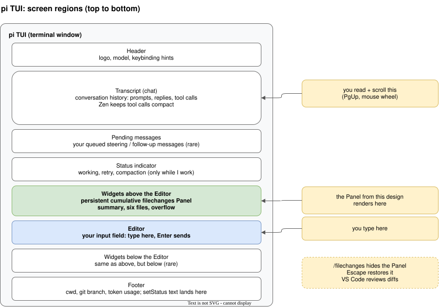
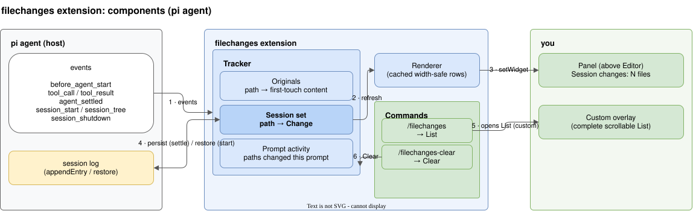
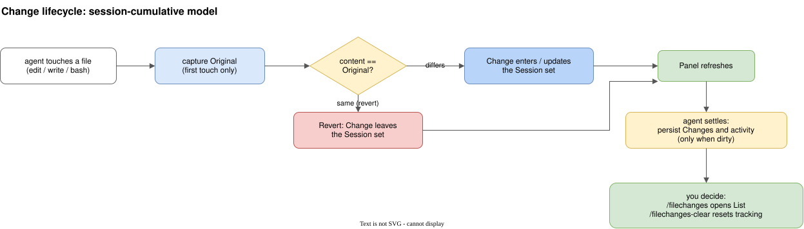

# Filechanges: design and vocabulary

## Purpose

Filechanges shows what remains to review without making you search the Transcript.
Zen keeps tool calls compact.
Filechanges keeps the Session set visible above the Editor, even after another prompt.
VS Code remains the place to review diffs through the existing Cmd+E workflow.

Implementation tasks: [performance](https://github.com/luiul/dotfiles/issues/85), [tracking](https://github.com/luiul/dotfiles/issues/86), [Panel and List](https://github.com/luiul/dotfiles/issues/87), and [verification](https://github.com/luiul/dotfiles/issues/88).

## Screen regions



| Pi region | Filechanges behavior |
| --- | --- |
| Transcript | Zen renders compact tool calls. Filechanges adds no automatic messages. |
| Widget, placement `aboveEditor` | The persistent Panel shows cumulative changes. |
| Editor | `/filechanges` opens the complete List. Escape closes it and returns to the Editor. |
| Footer | Not used by filechanges. |
| Custom overlay | The requested List shows complete paths, counts, Repo state, and prompt activity. It owns paging keys and fits the terminal. |

## Vocabulary

| Term | Meaning |
| --- | --- |
| Original | File content at first touch since session start or Clear. The reference for counts and revert detection. |
| Change | A file whose current content differs from its Original. |
| Kind | `created`, `modified`, or `deleted`. |
| Counts | Added and removed text lines against the Original, or `(binary)`. |
| Session set | All Changes tracked since session start or Clear. A new prompt never filters this set. |
| Prompt activity | Paths changed during the current or most recently completed user prompt. Display metadata only, not a separate diff. |
| Repo state | `untracked`, `staged`, `unstaged`, `conflicted`, or `committed`. Not persisted. |
| Revert | A file returns to its Original. Its Change and Original are forgotten. |
| Panel | The compact persistent widget above the Editor. |
| List | The complete scrollable view opened by `/filechanges`. |
| Clear | Forget the Session set, Originals, and Prompt activity without changing files. |
| Persist | Save Changes and Prompt activity as custom session entries outside the model context. |

Mode and Round are retired.
Older session entries still load.
Their saved Mode is ignored; their Round paths can restore Prompt activity.

## Panel

```text
│ Session changes: 7 files  +84/-23  ·  2 this prompt
│ modified …/extensions/filechanges.ts +18/-6  this prompt
│ created  scripts/test-filechanges-ui.ts +42/-0  this prompt
│ modified docs/filechanges-design.md +12/-8
│ modified …/extensions/README.md +12/-9
│ 3 more · /filechanges
```

- One summary line, up to six file rows, and one overflow hint. Eight Panel rows at most.
- Empty Session set: no Panel.
- Files sort by the last observed content change, newest first. An unchanged settlement does not reorder rows.
- Every line fits the terminal width. Directory prefixes shorten before filename tails.
- Routine Repo state and the activity label yield space before filenames and counts. Conflicts keep priority.
- All lines retain the dim left gutter. No background, top border, animation, or automatic notification.
- Kind and counts use semantic Pi colors. Routine Repo state and activity remain quiet metadata.

## Commands

| Command | Effect |
| --- | --- |
| `/filechanges` | Open the complete List. Arrow keys, Page Up, Page Down, Home, and End scroll. Escape or Ctrl+C closes it. |
| `/filechanges-clear` | Clear tracking and start fresh. Files remain untouched. |

Both commands take no arguments.
`/filechanges round` and `/filechanges all` show usage instead of filtering.
`/filechanges-mode` is no longer registered.
The List has no 30-file cutoff and does not submit a prompt or clear an Editor draft.
The Panel stays hidden for the entire List interaction, so changes appear only once.
Closing or failing to open the List restores the Panel from current tracking state.
A bounded overlay avoids the Editor slot's height limit and Pi's Transcript paging shortcuts.
RPC uses plain notification output on request; print mode has no Panel.

## Tracking and lifecycle



- `edit` and `write` capture content before a call and compare it afterward.
- Bash uses before/after Git status for the cwd repo and content snapshots of plausible command paths elsewhere.
- User prompt preparation resets Prompt activity, not the Session set. Retries do not create a new activity boundary.
- Settlement reconciles tracked files, refreshes Repo state, and persists dirty state.
- Revert forgets both the Change and Original, so later external edits to a reconciled file are not pulled into this session.
- Clear starts a new reference point. The next edit captures a fresh Original.
- Restore follows the active session branch. Branches are alternative histories, not one combined file list.
- Shutdown releases subscriptions, pending snapshots, caches, and session registry entries.



## Performance

Rendering reads cached state only.
It never launches Git or reads file content.
The Panel reuses its component and caches rows by state, width, and theme colors.
Unrelated Pi invalidations reuse the cached rows when these inputs are unchanged.
The tracker caches sorted display snapshots and avoids recalculating a diff for unchanged content.
Last-observed SHA-256 signatures retain only a digest and byte length, not a second copy of every file.
Prompt activity updates do not scan Git.
Repo refreshes reuse existing Bash status snapshots where possible.
Git subprocesses are bounded.
No polling, file watchers, new dependencies, or model calls are added.

Benchmark with Pi's Node runtime:

```sh
FILECHANGES_BENCH_BASELINE=/path/to/saved/baseline node scripts/bench-filechanges.ts
```

Compare current, candidate, and filechanges absent with the same Zen and runtime.
Separate cached rendering, invalidation, hooks, and real-host startup.
Report median and p95 rather than one run.
Measure subprocess counts, CPU, RSS, and idle writes alongside latency.

## Scope and accuracy limits

The Session set is not the repository's dirty-file list.
Unrelated working-tree changes should not appear merely because they existed before the session.
Counts measure content changes against an Original, not Git HEAD, while that Original remains in memory.

Bash detection is best effort.
Constructed paths, globs outside the cwd repo, and directory contents are not fully covered.
Candidate snapshots are capped at 40 paths and 10 MB per regular file.
Git status alone does not prove authorship when another process edits concurrently.
Existing snapshot read failures can look like missing files.
A Git diff failure or timeout produces zero counts rather than exact counts; file presence remains useful, but those counts are not guaranteed.

Restore does not persist file contents.
For files in the cwd repo, Originals are rebuilt from Git HEAD.
Therefore exact first-touch counts are not guaranteed after reload when the original file was already dirty.
Outside that repo, saved counts remain as recorded until a new touch captures an Original.

Repo state refreshes on settlement, Bash results, restore, and explicit `/filechanges`, not on every prompt or idle time.
External staging may remain stale until the next refresh.
An index change counts as `staged`, including `MM`; there is no separate partially staged state.
Ignored or unknown files have no Repo state.

Defaults ignore lockfiles, `.env*`, generated directories, Git internals, and editor temporary files.
`filechanges.ignore` in project `.pi/settings.json` overrides global settings.
OS temporary directories remain excluded at all tracking entry points and restore.
Binary files use NUL-byte detection and show `(binary)` rather than line counts.

## Verification

```sh
bun scripts/test-filechanges-extension.ts
bun scripts/test-filechanges-components.ts
bun scripts/test-filechanges-tracker.ts
node scripts/test-filechanges-live.mjs
```

Tests cover cumulative visibility after a prompt with no edits, activity boundaries, Clear, Revert, restore, binary and ignored files, Repo state, Unicode paths, narrow widths, resizing, themes, complete List scrolling, draft preservation, and shutdown.
Zen regressions remain part of verification.
